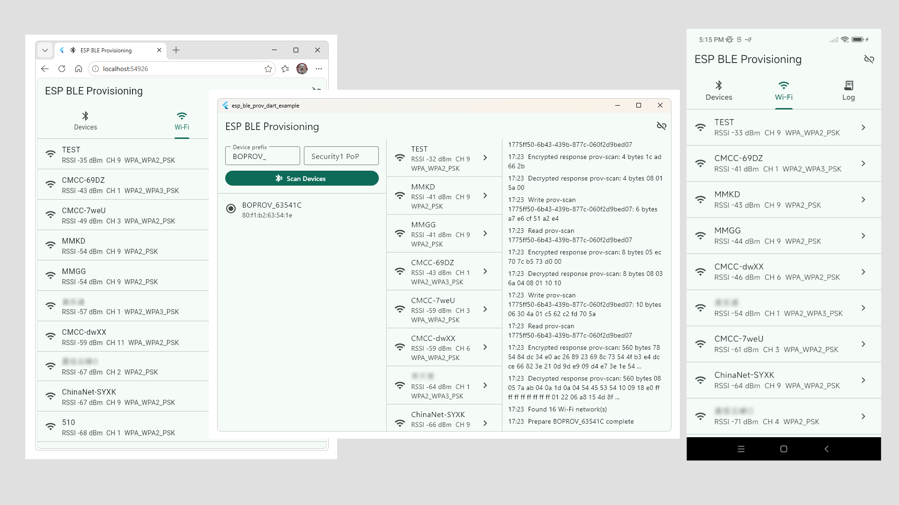

# esp_ble_prov_dart
[](https://pub.dev/packages/esp_ble_prov_dart)
[](https://pub.dev/packages/esp_ble_prov_dart/score)
[](https://pub.dev/packages/esp_ble_prov_dart/score)
[](https://pub.dev/packages/esp_ble_prov_dart/score)
[](https://pub.dev/packages/esp_ble_prov_dart)

A **pure Dart** implementation of the Espressif network provisioning protocol for Flutter.

This package is a Dart port of the open-source JavaScript implementation [`esp-ble-prov`](https://github.com/nikas-belogolov/esp-ble-prov). By rewriting the protocol logic entirely in Dart and leveraging [`universal_ble`](https://pub.dev/packages/universal_ble) for cross-platform BLE access, it eliminates any dependency on Espressif's official native SDKs.

The result is a unified, lightweight, and truly multi-platform provisioning solution without the headache of managing native bindings or platform-specific builds.

If this project saved you time, native binding headaches, or lines of code, consider buying me a coffee. Your support helps keep this project maintained, thank you!

<p align="center">
  <a href="https://ko-fi.com/oldrev">
    
  </a>
</p>


## Supported Platforms

Since it is written in pure Dart and uses `universal_ble`, this package works seamlessly across **all Flutter-supported platforms**:

| Android |  iOS  | macOS |  Web  | Linux | Windows |
| :-----: | :---: | :---: | :---: | :---: | :-----: |
|✅|✅|✅|✅|✅|✅|




## Features

* **Zero Native Dependencies:** 100% pure Dart implementation of Espressif's provisioning protocol.
* **ESP BLE Provisioning over GATT:** Full control over the provisioning state machine.
* **Dynamic Endpoint Mapping:** Reads ESP endpoint names from GATT descriptors when the transport supports it, with explicit mappings and UUID derivation as fallbacks.
* **Wi-Fi Utilities:** Scan for nearby networks, configure credentials, and apply Wi-Fi logic.
* **Protobuf-Powered:** Leverages structured ESP provisioning messages.
* **Security Support:** Fully implements `Security0` (no security) and `Security1` (Curve25519 key exchange + AES-CTR).
> *Note: `Security2` (SRP6a/AES-GCM) is currently exposed as an API placeholder and will throw a `ProvisionerError` until verification is complete.*


## Status & Architecture

This package is a Dart port of the open-source JavaScript implementation [`esp-ble-prov`](https://github.com/nikas-belogolov/esp-ble-prov)) (originally targeting Web Bluetooth).

The built-in BLE endpoint UUIDs follow ESP-IDF's default `wifi_prov_mgr` mapping:

| Endpoint | Short UUID | Description |
| --- | --- | --- |
| `prov-ctrl` | `0xFF4F` | Control session and state |
| `prov-scan` | `0xFF50` | Trigger and fetch Wi-Fi scan results |
| `prov-session` | `0xFF51` | Security handshake / session establishment |
| `prov-config` | `0xFF52` | Apply/Get Wi-Fi configurations |
| `proto-ver` | `0xFF53` | Protocol version check |

### Custom Endpoints

Endpoint mapping precedence is: explicit registration, GATT descriptor, then
ESP-IDF UUID derivation. The built-in Web transport reads the `0x2901`
characteristic user-description values and therefore discovers custom endpoint
names automatically. `universal_ble 3.x` does not expose descriptor values on
native platforms, so native clients use UUID derivation unless an explicit
mapping is registered.

ESP-IDF normally assigns application-defined provisioning endpoints
sequentially after the built-in ones (`0xFF54`, `0xFF55`, etc.). Register them
by index when descriptor values are unavailable:

```dart
provisioner.registerCustomEndpoint('device-id'); // Index 0 -> 0xFF54
provisioner.registerCustomEndpoint('factory-info', index: 1); // Index 1 -> 0xFF55

```

The resolved source is available through `provisioner.endpointUuidSources`.

## Installation

Add the package to your Flutter project:

```yaml
dependencies:
  esp_ble_prov_dart: ^0.4.0

```

Then run:

```bash
flutter pub get

```

### Platform Permissions

Ensure you configure the specific Bluetooth permissions required by your target operating systems (e.g., `Info.plist` for iOS/macOS, `AndroidManifest.xml` for Android). Refer to the [`universal_ble`](https://pub.dev/packages/universal_ble) documentation for setup details.

## Basic Usage

```dart
import 'package:esp_ble_prov_dart/esp_ble_prov_dart.dart';

Future<void> provisionDevice() async {
  final provisioner = EspBleProvisioner(
    deviceNamePrefix: 'PROV_',
    security: Security1(pop: 'your_proof_of_possession'),
  );

  // 1. Connect and establish an encrypted session
  await provisioner.connect();
  await provisioner.establishSession();

  // 2. Scan for Wi-Fi networks via the ESP device
  final networks = await provisioner.scan();

  // 3. Send and apply credentials
  await provisioner.sendCredentials(
    WiFiConfig(
      ssid: 'Your Wi-Fi SSID',
      passphrase: 'Your Wi-Fi Password',
      channel: networks.isNotEmpty ? networks.first.channel : 0,
    ),
  );

  await provisioner.disconnect();
}

```

### Web Bluetooth: authorize, then connect

Web Bluetooth does not provide normal background BLE scanning. It exposes a
browser device chooser through `requestDevice()`, which must be called directly
from a user gesture such as a button click. Authorize one device first, then
connect using the returned handle:

```dart
Future<void> onProvisionButtonPressed() async {
  final device = await provisioner.authorizeDevice();
  await provisioner.connect(device: device);
  await provisioner.establishSession();
}
```

Do not call `authorizeDevice()` from `initState`, a timer, or after unrelated
asynchronous work. For compatibility, `scanDevices()` opens the same chooser on
Web and returns at most one device; it is not a scan there. Calling
`connect()` without a device on Web is rejected deliberately.

## Protobuf Generation

Protocol messages live in the [`protos`](./protos) directory. If you modify or need to regenerate the Dart protobuf definitions:

```powershell
dart pub global activate protoc_plugin
.\tool\generate_protos.ps1

```

*(Generated files are output to `lib/src/proto/generated`)*

## Tests

The hardware-independent suite uses deterministic fake transports and covers
protobuf validation, boundary values, security handshakes, connection
generations, concurrent workflows, transport failures, Web chooser semantics,
and resource cleanup:

```bash
flutter test
```

Real Web Bluetooth browser integration and ESP hardware interoperability remain
manual because they require a user gesture and external devices.

## Debugging

If you need to inspect raw encrypted/decrypted communication during development, enable payload logging:

```dart
final provisioner = EspBleProvisioner(
  deviceNamePrefix: 'PROV_',
  security: Security1(pop: 'pop'),
  logPayloads: true, // Prints hex dumps of communication to log callback
);

```

### BLE Endpoint Timing and Wi-Fi Scan Paging

`responseDelay`, `responseTimeout`, and `readRetryInterval` apply to every
provisioning endpoint write/read exchange, including `prov-session`,
`prov-scan`, `prov-config`, `prov-ctrl`, and custom endpoints.

When many access points are nearby, scan responses can become large enough to
trigger BLE read timeouts on some devices or platforms. The default `scan()`
implementation reads results in small pages. For constrained devices, tune the
MTU, endpoint timeout, retry interval, scan timeout, and page size:

```dart
final provisioner = EspBleProvisioner(
  deviceNamePrefix: 'BOPROV_',
  security: Security1(pop: ''),
  mtu: 256,
  responseTimeout: const Duration(seconds: 20),
  readRetryInterval: const Duration(milliseconds: 250),
);

final networks = await provisioner.scan(
  timeout: const Duration(seconds: 45),
  pageSize: 4,
);

```

### Lifecycle and Custom Endpoints

Provisioning operations are serialized as complete transactions. For custom
protocomm endpoints, prefer the atomic request/response API so Security1 stream
state cannot be interleaved with another operation:

```dart
provisioner.registerCustomEndpoint('device-id');
final response = await provisioner.exchangeValueToEndpoint(
  'device-id',
  Uint8List.fromList(requestBytes),
);

await provisioner.dispose(); // Idempotently disconnects and releases resources.
```

An uncertain BLE write/read failure invalidates a stateful Security1 session.
Disconnect and establish a new session instead of retrying on the same session.
Payload bytes are omitted from logs by default; `logPayloads: true` is intended
only for controlled debugging and may expose provisioning data.

### Cancellation, errors, and public models

Long-running discovery, connection, Wi-Fi scan, and credential workflows accept
a cooperative cancellation token:

```dart
final cancellation = ProvisioningCancellationToken();
final operation = provisioner.scan(cancellationToken: cancellation);
cancellation.cancel();
await operation;
```

`ProvisionerError` exposes a stable `code`, operation/endpoint context, original
`cause`, stack trace, and retryability hint. Endpoint timing defaults can be
grouped with `ProvisioningTimeouts`; existing individual constructor arguments
remain supported and take precedence.

Public Wi-Fi results now use package-owned `WiFiAuthMode`,
`WiFiStationState`, and `WiFiConnectFailureReason` enums instead of generated
protobuf types. Unknown future protocol values map to `unknown`. Byte-array
fields are defensively copied and exposed as unmodifiable views.

---

## License

This Flutter port is released under the **MIT License**. See [`LICENSE`](./LICENSE).

Upstream JavaScript reference project [`esp-ble-prov`](https://github.com/nikas-belogolov/esp-ble-prov) is also MIT licensed.

- Copyright © 2026 Nikas Belogolov
- Copyright © 2026 Wei Li
